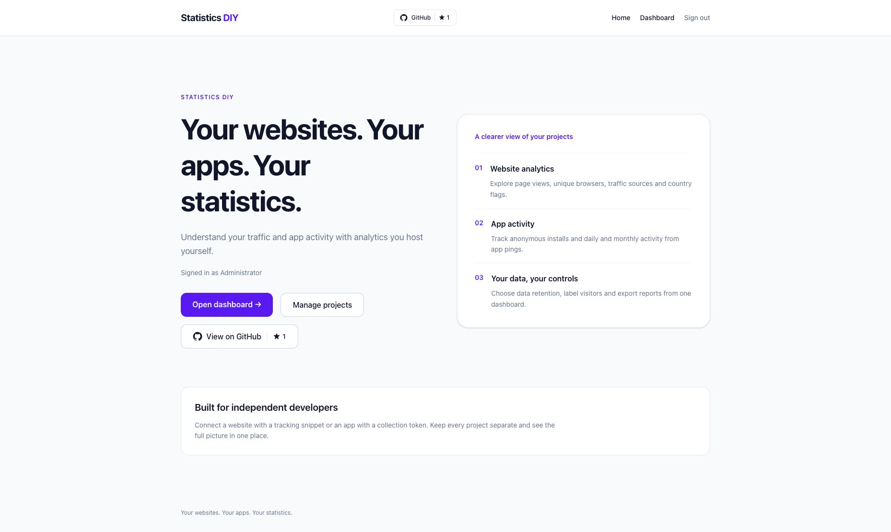
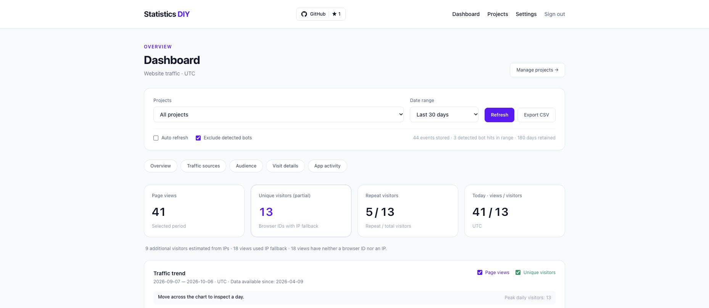
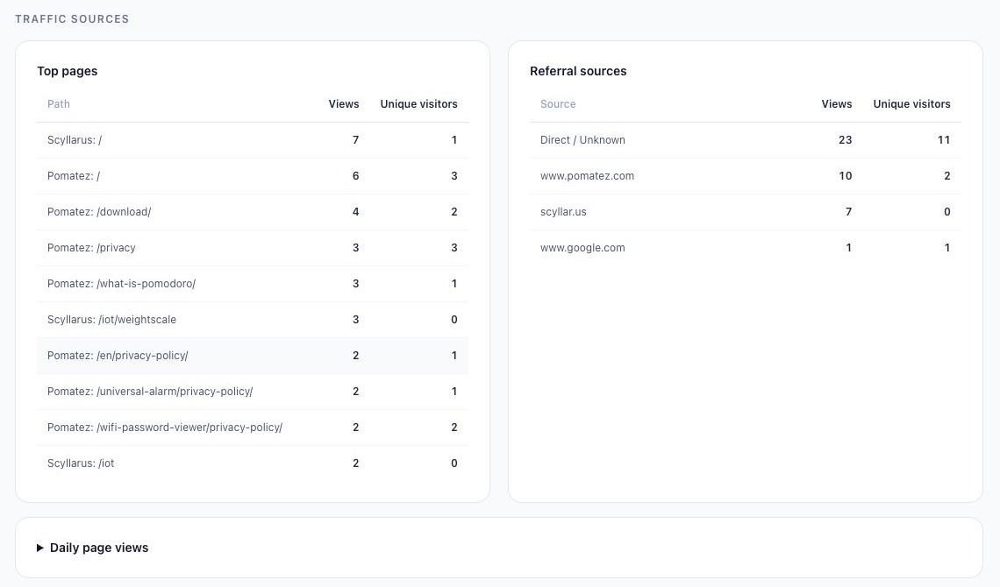
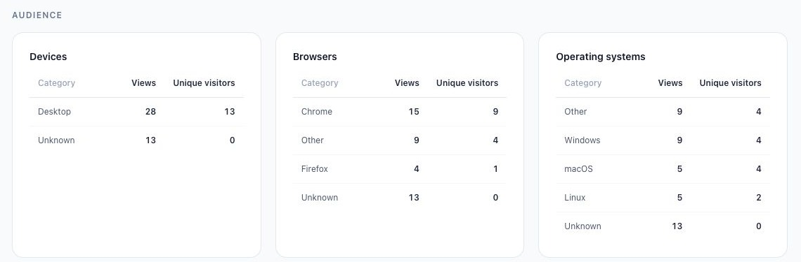
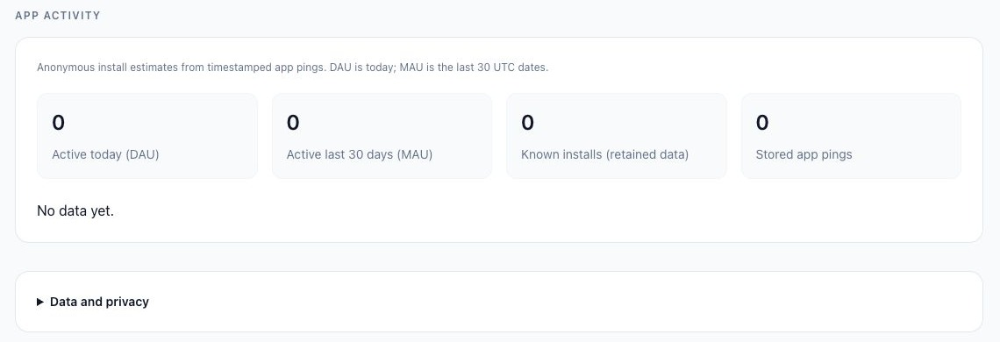

# Statistics DIY

Self-hosted website and app analytics for independent developers.

**Your websites. Your apps. Your statistics.**

Project domain: `statistics.diy`

## Screenshots

Captured from [statistics.diy](https://statistics.diy/) on October 6, 2026.

### Home



### Dashboard overview

The dashboard screenshot shows the overview controls and summary cards; visitor IP addresses and visit details are outside the captured area.



### Traffic sources

Popular pages and referral sources.



### Audience

Device, browser, and operating system breakdowns, excluding the IP address table.



### App activity

Daily and monthly active installs, retained installs, and stored app pings. This screenshot shows the current empty state.



### Project trends

Daily unique visitors per project, one colored line per project.


These additional screenshots were captured on October 7, 2026.

## One-line installation

On Linux or macOS with **Docker running and Docker Compose v2 installed**:

```bash
curl -fsSL https://raw.githubusercontent.com/scyllarusllc/statistics.diy/main/install.sh | bash
```

This builds a small Node.js image and starts it with a SQLite database in a dedicated Docker Compose stack. Open **http://localhost:8080** and sign in as **Administrator**. The generated password is the `ADMIN_PASSWORD` value in `~/.local/share/statistics-diy/.env` (created with private permissions and preserved on retries). Only its Argon-style scrypt hash, `ADMIN_PASSWORD_HASH`, is given to the container.

To choose a different port and installation directory:

```bash
curl -fsSL https://raw.githubusercontent.com/scyllarusllc/statistics.diy/main/install.sh | STATISTICS_DIY_PORT=8081 STATISTICS_DIY_DIR="$HOME/statistics-diy-server" bash
```

These settings apply on first installation. Reruns reuse the existing `.env` and the persistent `data` volume. Manage the default installation:

```bash
cd ~/.local/share/statistics-diy
docker compose ps
docker compose logs --tail=100
docker compose stop
docker compose start
```

The web port binds to localhost. Public deployment requires a reverse proxy with HTTPS (set `APP_ORIGIN` to the public origin) and a backup plan. To back up, stop the stack and copy `statistics.sqlite*` out of the `data` volume.

## Migrating from Frappe

Earlier versions ran on Frappe and MariaDB. The Node.js version imports that data without changing anything on your websites: the tracker URL (`/assets/statistics_diy/js/tracker.js`), the collection endpoint (`/api/method/statistics_diy.api.collect`) and every project's `data-key` stay the same, and project IDs, collection keys, app tokens, event IDs and the anonymized visitor/session/install hashes are copied verbatim.

1. Start the new service and keep the old MariaDB reachable.
2. Run the importer with any command that feeds SQL on stdin to the old database:

```bash
node scripts/migrate.mjs --to /absolute/path/statistics.sqlite \
  --from-mariadb 'docker exec -i OLD_DB_CONTAINER mariadb -uroot -pOLD_PASSWORD OLD_SITE_DATABASE'
```

The old site's database name is in `sites/<site>/site_config.json` (`db_name`). The importer backs up an existing target, imports in one transaction, is safe to re-run (existing rows are skipped), and prints source and target counts per table. Stop the old service, switch DNS or the reverse proxy to the new one, and rerun the importer once to pick up events collected in between. Retention (`Analytics Settings`) is imported too. In Docker, run it against the `data` volume, e.g. `docker compose run --rm -v "$PWD/import:/import" app node scripts/migrate.mjs --to /data/statistics.sqlite --from-mariadb '...'` with network access to the old database.

The administrator account is no longer a Frappe user; set `ADMIN_PASSWORD_HASH` (`node scripts/hash-password.mjs 'password'`).

## Status

Statistics DIY is a Node.js (22.13+) application with a built-in SQLite database (`node:sqlite`). Projects, page-view and app-activity collection, the dashboard, retention and exports described below are implemented.

## Why this project exists

Independent developers often maintain both a website and a desktop or mobile app. Statistics DIY aims to bring website traffic and app usage into one simple dashboard that developers can run on their own infrastructure.

The initial idea comes from the website and app analytics features in VibeCMS. Those features provide useful experience with collection and presentation, while this project will define its own independent data model and deployment workflow.

Existing projects such as [Umami](https://docs.umami.is/docs/about) and [Plausible](https://plausible.io/open-source-website-analytics) already offer self-hosted website analytics. Statistics DIY will focus on a small, understandable experience that combines websites and apps.

## First release scope

### Website analytics

- Page views and unique visitor estimates.
- Popular pages and referral sources.
- Country, browser, operating system, and device breakdowns.
- Daily trends with explicit reporting timezone and retention boundaries.
- Per-project daily unique visitor trend lines, one color per project, at the top of the dashboard overview.
- Integration through a lightweight JavaScript snippet.

### App analytics

- First-seen anonymous installs, rather than an unverifiable count of all installations.
- Daily and monthly active installs based on recorded activity.
- App version, operating system, and release bundle breakdowns.
- Ping counts within the selected reporting period.
- Integration through a documented HTTP endpoint suitable for desktop and mobile apps.

### Project management and deployment

- Multiple websites and apps in one instance.
- Project-scoped collection credentials and isolated reporting data.
- Administrator authentication and project access controls.
- One-line Docker installation or running the Node.js app directly.
- Setup documentation and synthetic demonstration data.

Session replay, experiments, advertising attribution, and payment processing are outside the first release scope.

## Data accuracy principles

1. Store timestamped events or daily activity records. A mutable `last_seen` field alone cannot reconstruct historical daily activity.
2. Define DAU as distinct installs active during a calendar day in the reporting timezone. Label rolling 24-hour activity separately.
3. Define MAU as distinct installs active within a documented 30-day window. Counts of installs are not counts of people.
4. Calculate period ping totals from activity within that period, not lifetime counters of currently active installs.
5. Separate website visitor estimates from app install identities. Avoid presenting either as an exact count of people.
6. Distinguish missing or expired data from observed zero activity. Charts must show the available retention window.
7. Keep project identity on all events, activity records, aggregates, and reporting queries.
8. Support retries and deduplication so repeated submissions do not silently inflate statistics.

## Privacy direction

- Avoid persistent browser fingerprinting by default.
- Website IP reports retain visitor addresses under the configured retention policy. App activity uses anonymous install IDs and does not store IPs.
- Use client-generated, resettable anonymous install IDs for optional app analytics.
- Respect website tracking opt-out settings and document collection behavior.
- Document how website unique visitor estimates are calculated and their limitations before implementation.
- Keep credentials, production data, and identifiable sample data out of the repository.

Exact collection defaults and retention periods will be documented as the implementation develops.

## Architecture

- **Runtime:** Node.js 22.13+ with no web framework; `server.mjs` routes requests, `src/` holds collection, reporting and auth logic.
- **Database:** SQLite through the built-in `node:sqlite` module (`src/db.mjs` creates and versions the schema). Tables: `projects`, `events`, `visitors`, `app_activity`, `settings`, `admin_sessions`.
- **Collector:** `POST /api/method/statistics_diy.api.collect` (websites) and `POST /api/method/statistics_diy.activity.ping` (apps). The path names are kept for compatibility with trackers already deployed.
- **Dashboard:** server-rendered Nunjucks templates in `views/`, vanilla JavaScript and compiled Tailwind CSS in `public/`, served at `/assets/statistics_diy/`.
- **Authentication:** one administrator (`ADMIN_USERNAME`, `ADMIN_PASSWORD_HASH`), cookie sessions stored hashed in SQLite, CSRF token on every state-changing request.
- **Background work:** an in-process timer purges data past the retention period.
- **GeoIP:** IPinfo Lite country lookups with `STATISTICS_IPINFO_TOKEN`, cached for 24 hours; optional offline `.mmdb` fallback through `STATISTICS_GEOIP_DATABASE`.

Collection validation and aggregation live in `src/` separately from page rendering. A separate collector or analytics database can be introduced later if measured traffic justifies it.

## Local development

Requires Node.js 22.13 or newer.

```bash
cp .env.example .env     # set ADMIN_PASSWORD_HASH using scripts/hash-password.mjs
make dev                 # npm install && node --watch server.mjs
```

Open **http://127.0.0.1:8080**. Environment variables: `PORT`, `BINDING`, `APP_ORIGIN`, `DATABASE_PATH`, `ADMIN_USERNAME`, `ADMIN_PASSWORD_HASH` (or `ADMIN_PASSWORD` for development only), `STATISTICS_PROXY_TOKEN`, `STATISTICS_GEOIP_DATABASE`. Behind a trusted proxy, send the visitor address in `X-Statistics-Client-IP` together with `X-Statistics-Proxy-Token`; other forwarding headers are ignored.

## Development checks

```bash
npm test
bash -n install.sh
```

The tests cover collection, deduplication, origin checks, project isolation, admin sessions and CSRF, report windows, the unchanged tracker script path, tracker behavior and dashboard chart interactions.

Rebuild the committed CSS after changing templates or Tailwind classes:

```bash
npm run build:css
```


## License

MIT is the proposed license. A license file and copyright attribution will be added before the first public release, after confirming ownership and any reused code licenses.

## First analytics workflow

The app now includes **Analytics Project**, **Analytics Event**, a page-view tracker,
and custom Tailwind CSS pages at `/admin/dashboard` and
`/statistics_diy/admin/projects` (administrator access).

1. Sign in at `/statistics_diy/login`, open `/statistics_diy/admin/projects` and select **创建项目**.
2. Enter the project name and exact website origin, e.g. `https://example.com`.
3. Save and expand **获取追踪代码**, then copy the snippet into the website's HTML.
4. Choose a project on `/admin/dashboard` to open `/admin/project/<domain>` and see that project's full analytics. Select a 7/30/90-day range or export the report as CSV. Existing `/admin/dashboard?project=<id>` links redirect to the domain page.

The project page starts with a live activity map and a recent visitor list to its left. It counts distinct visitors seen in page views during the last 1, 10, 30 or 60 minutes and updates every 15 seconds while the tab is visible. The hero also shows the latest activity time, popular pages, referral sources and device types for that window. Visitor cards show their latest page, source, device details and view count. New visitors animate into the list and pulse on the map; reduced motion settings disable these effects. The selected window is saved in browser local storage for each project. The map uses country estimates rather than exact visitor locations. Its boundary data comes from [Natural Earth](https://www.naturalearthdata.com), packaged locally as a small JSON asset.

The current snippet uses `https://statistics.diy` as the collector host. For another
installation, adjust the script URL. Collection keys are public project identifiers,
not secrets. Origin checks discourage accidental cross-project submissions but do
not authenticate arbitrary HTTP clients or prevent forged analytics.

This first slice records server receipt time in UTC, pathname and referrer hostname.
It stores visitor IP addresses for IP reports, but does not store query strings or cookies. The tracker uses an anonymous browser identifier for unique visitor estimates, described below. The
tracker honors browser Do Not Track. It tracks initial document loads; SPA navigation,
app activity, country/device reports and automated retention are not
implemented. Reports cover selectable 7/30/90 UTC calendar days, including today; events currently remain stored
until explicitly deleted. Collection is capped at 1,000 requests per project per minute.


This verification includes an HTTP request through `https://statistics.diy`; adapt
that URL when validating another deployment.

### Custom administration UI

Login, projects (including creation/editing), and the dashboard use standalone
HTML templates, vanilla JavaScript and compiled Tailwind CSS. The Node.js server supplies sessions, CSRF protection, permissions and database operations.

Rebuild the committed CSS after changing templates or Tailwind classes (Node 20+):

```bash
npm ci
npm run build:css
```


### Report ranges and exports

Dashboard ranges include the current UTC date and the preceding 6, 29 or 89 dates.
Today is partial. Days without events show zero; events outside the date boundaries
are excluded. Page and referral tables include the top 10 entries. Empty referrers
are labelled Direct / Unknown. The CSV includes daily totals and both top-10 tables
for the selected project and date range; it is not a raw event export.


The dashboard defaults to **All projects**, showing combined page views and daily
traffic plus a total for every project, including projects with zero traffic or
collection disabled. Select a project or click its summary row for details.
Combined top pages remain separated by project even when paths match. CSV exports
include project totals and identify the project for each top-page entry.

### Unique visitor estimates

The tracker now assigns an anonymous UUID in the tracked website's localStorage,
separately for each project, with a fixed 90-day lifetime. The collector stores a
project-scoped SHA-256 hash. Unique visitors count distinct browser identifiers
within the selected period; daily counts deduplicate separately each UTC day.
All-project totals sum project-specific unique counts rather than deduplicating
people across websites. Different browsers, cleared storage and expiration can
increase counts. These are estimates of browsers, not people.

Older events or storage-blocked browsers have no visitor identifier. Their views
remain included and can use IP fallback when an address is recorded; the dashboard displays the
number of unmeasured views. Daily unique counts must not be summed to determine
period uniques. CSV exports include uniques for project and daily rows.

The tracker uses a stable, unversioned URL. The reverse proxy must send
`Cache-Control: no-cache, max-age=0, must-revalidate` for this file, so browsers
revalidate it on each page load. Existing versioned URLs continue to work. Add `data-visitors="off"` to the script to disable
visitor storage while still counting page views. Do Not Track and Global Privacy
Control disable both collection and visitor storage.

### Visitor details and app analytics

The dashboard now supports 365-day selection, optional auto refresh every minute
while the tab is visible, and heuristic User-Agent bot exclusion. It shows repeat
browser IDs (more than one page view in the selected period), today's UTC totals,
devices/browsers/operating systems, recent visits and editable project-specific
visitor labels. Both views and unique browsers are shown for pages, referrers and
breakdowns. Historical events without metadata appear as Unknown; session counts
are unavailable for events without session IDs. New tracker sessions are per tab,
renewed after 30 minutes of inactivity between tracked page loads. No persistent
device fingerprint or raw User-Agent is stored.

The stable tracker URL delivers session and timezone collection updates without changing website snippets.
Detected bots are stored but excluded from reports by default. Bot detection is
heuristic, not proof that every included visitor is human. Country/city lookup is not configured. IP addresses are now stored for recent visits and top-IP reports, under the event retention policy. The reference statistics are not seed data.

Expand **App integration** on a project for its separate app collection token.
Send JSON to `POST /api/method/statistics_diy.activity.ping` with `token`,
`install_id` (random UUID stored on first launch), `event_id` (new UUID per ping),
`platform` (Windows/Linux/macOS/iOS/Android/Other) and `app_version`. Retry with the
same event ID to avoid double counting. The token identifies app traffic; it is
not proof of a real install, and distributing it in a client cannot prevent forged
activity. Installs are project-scoped estimates, not people. DAU counts installs
with pings today in UTC; MAU counts installs active on the latest 30 UTC dates.
These counters use timestamped events, not a mutable last-seen value, and are
independent of the selected website report range.

Settings controls retention (30/90/180/365 days, default 180). Daily cleanup deletes
expired website/app events and orphaned labels. Dates outside retention are shown
as unavailable instead of zero. Known installs cover retained activity, not
lifetime installs. The **Clear analytics data** action requires typing
`DELETE ANALYTICS`; it preserves project configurations. No live data is cleared
merely by adding this control.

Verification uses temporary data and rolls changes back:

The traffic trend supports visible hover/focus tooltips, views/visitor series
checkboxes, and clickable day selection. Selecting a retained day filters website
report totals, tables and exports while keeping the full-range trend visible.
**Back to full range** clears the selection. Arrow keys, Home/End and Enter/Space
navigate and select days. Dates outside retention cannot be selected. Today's
counters and app DAU/MAU retain their explicitly labelled time windows.

### IP addresses

New website events store normalized IPv4/IPv6 addresses. Recent visits, the top-15
IP table and CSV exports include them. Existing records without IPs remain
unrecorded; IP is used as a fallback only when a browser ID is missing. These records follow the
same retention and clear-data controls as other website events. App pings do not
store IPs. Location lookup remains unconfigured.

The current Caddy proxy overwrites `X-Statistics-Client-IP` and authenticates that
header to the app using `X-Statistics-Proxy-Token`, matched against the private
`STATISTICS_PROXY_TOKEN` environment variable. It accepts `CF-Connecting-IP` only
from Cloudflare's published network ranges; other requests use the direct peer
address. Unauthenticated forwarded headers are ignored by the app. Future proxy
deployments must configure the same trust boundary rather than passing arbitrary
client headers. Keep the proxy token private and Cloudflare ranges current.

### Country flags

The visitor countries panel shows flags, views and distinct IP counts by country. Recent visits has a country column with flags and names, and Top IPs shows country flags with the country name on hover.
Set `STATISTICS_IPINFO_TOKEN` in the server's `.env` to use [IPinfo Lite](https://ipinfo.io/developers/lite-api). The server sends public visitor IPs to IPinfo in batches, keeps the token server side, and caches successful country results for 24 hours. Private, invalid or unknown addresses have no flag. Country assignments are approximate, including for historical IPs.

An optional offline MMDB at `/data/geoip/city.mmdb` or `/data/geoip/country.mmdb` provides fallback results if IPinfo is unavailable. Set `STATISTICS_GEOIP_DATABASE` to use another path. The dashboard credits [IPinfo](https://ipinfo.io) and [DB-IP](https://db-ip.com) for the respective data sources.

### Public homepage

`/statistics_diy/user/homepage` is the custom Tailwind homepage and is also served
at `/`. Guests can sign in; administrators get dashboard and project links. 
The homepage supports the same English/Chinese preference as the rest of the site.

### Unique-count coverage and cached trackers

The visitor card is marked **partial** when some views lack browser IDs and shows
how many views are identifiable. If a project has views but no visitor IDs, its
unique total is shown as unavailable instead of a definitive zero. Historical
browser IDs cannot be reconstructed; recorded IPs can provide fallback estimates.

After changing a tracker cache policy, existing CDN entries may still serve an
older script until expiry. Purge the exact stable tracker URL once in Cloudflare:
`https://statistics.diy/assets/statistics_diy/js/tracker.js`. The origin already
sends revalidation headers, so websites do not need versioned snippet edits.

Browser-ID stability checks can be run with:

```bash
node tests/test_tracker.js
```

### IP fallback for visitor estimates

Reports prefer browser IDs. When a view has no browser ID, its recorded IP is used
as a fallback. A repeated IP counts once per project in the report scope. If that
IP also appears with browser IDs in the same scope, missing-ID views use a
deterministic existing browser representative instead of adding another visitor.
Known browser IDs remain distinct even when they share an IP, and a browser ID
remains one visitor when its IP changes. Daily/category reports resolve the fallback
within their own day/category scope. This is an estimate: shared IPs can undercount,
changing IPs can overcount, and ambiguous missing-ID views cannot be attributed to
a particular browser with certainty.

The card reports extra visitors estimated from unmatched IPs, views using fallback,
and views lacking both identifiers. Events lacking both stay unavailable; historical
records are not rewritten. Visitor labels remain tied to explicit browser IDs.

City and region appear only when the optional offline city database has that information. IPinfo Lite supplies country data, not city data.

The trend now snaps pointer movement to the nearest date, displays a floating
metrics tooltip and crosshair, and supports tap selection. Selecting the same day
again resets the report. Vertical touch scrolling does not trigger selection.
Keyboard users focus the chart once and use arrows/Home/End to inspect dates,
Enter/Space to select and Escape to reset. At least one series stays enabled.
Loading filtered details preserves the chart rather than hiding the report.

```bash
node tests/test_trend.js
```
